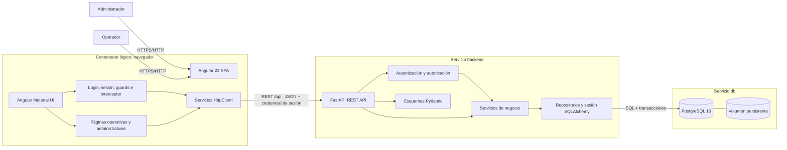
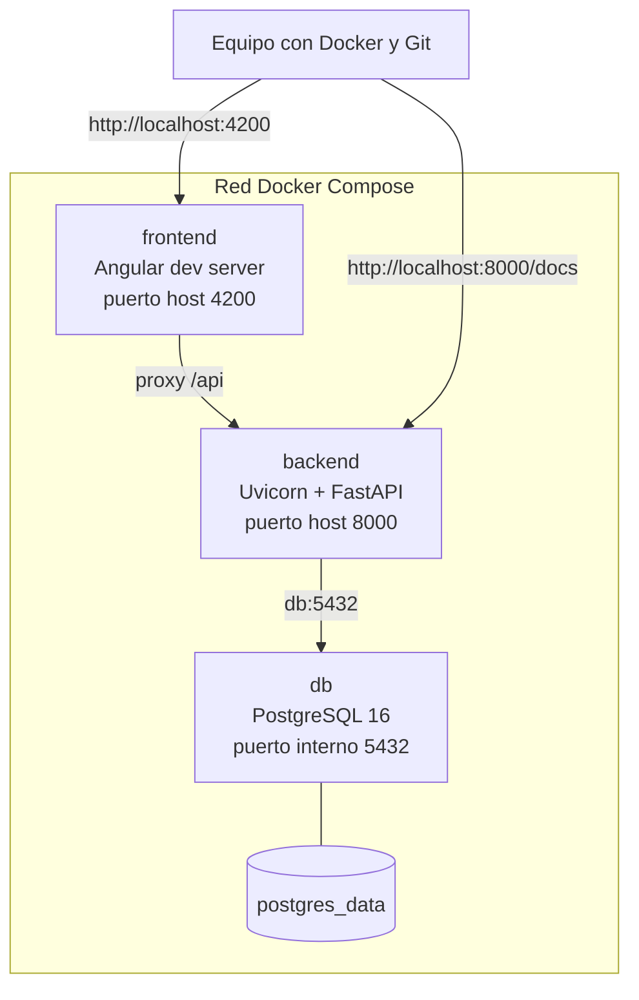
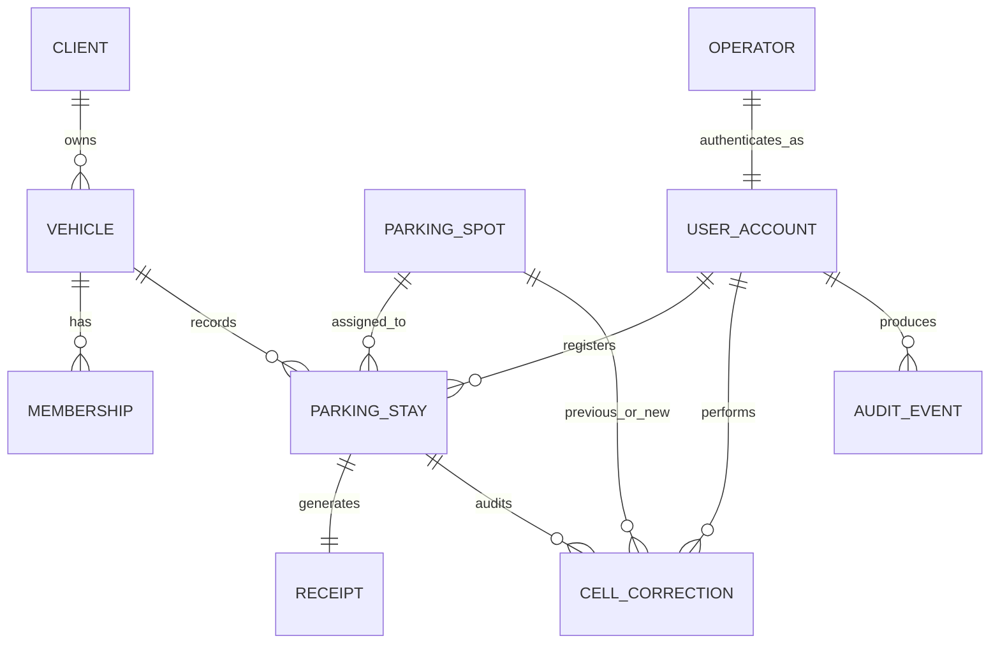
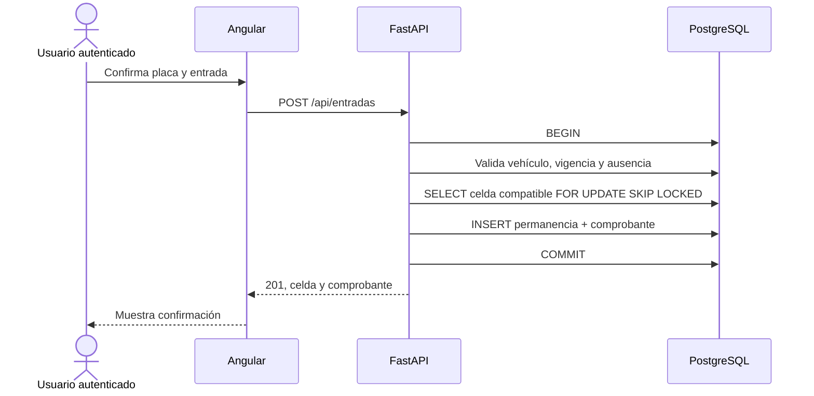

# Arquitectura técnica de Autos Colombia — Iteraciones 1 y 2

Este documento define la arquitectura conjunta para la gestión de entrada y salida de vehículos, autenticación de empleados, autorización por perfiles y administración de celdas. Complementa el [PRD de Iteración 1](./PRD_Autos_Colombia_Iteracion_1.md) y el [PRD de Iteración 2](./PRD_Autos_Colombia_Iteracion_2.md), y sirve como fuente para construir los diagramas de arquitectura, componentes, paquetes, clases, secuencia y despliegue en StarUML.

> **Decisión central:** se implementará un monolito web modular, desplegado con Docker Compose, con Angular 22 en el navegador, FastAPI como única autoridad de negocio, SQLAlchemy como capa de persistencia y PostgreSQL 16 como fuente de verdad.

## 1. Ficha de la arquitectura

| Área | Decisión |
|---|---|
| Frontend | Angular 22, TypeScript y Angular Material |
| Backend | Python 3.12 y FastAPI |
| Persistencia | SQLAlchemy 2.x |
| Base de datos | PostgreSQL 16 |
| Comunicación | API REST con JSON sobre HTTP |
| Entorno | Docker Compose |
| Estilo | Monolito modular en tres servicios, sin microservicios |
| Estado operativo | Derivado de las permanencias abiertas en PostgreSQL |
| Alcance | Iteraciones 1 y 2: operación del parqueadero, autenticación, perfiles, auditoría y administración de celdas |

## 2. Principios obligatorios

1. **FastAPI decide:** Angular solicita operaciones, pero no asigna celdas ni confirma estados por sí mismo.
2. **PostgreSQL protege la integridad:** las restricciones críticas no dependen solo de validaciones del frontend.
3. **Las operaciones críticas son atómicas:** entrada, comprobante y celda se confirman juntas; salida, uso del comprobante y liberación también.
4. **La ocupación se deriva:** no se mantiene un contador independiente que pueda desincronizarse.
5. **La solución se mantiene sencilla:** no se usarán microservicios, NgRx, colas, cachés ni proveedores externos de identidad; la autenticación será local y suficiente para los dos perfiles requeridos.
6. **Cada capa tiene una responsabilidad:** presentación, contrato HTTP, negocio, persistencia y datos se mantienen separadas.
7. **Los datos sobreviven a los contenedores:** PostgreSQL utiliza un volumen nombrado.
8. **Los rechazos no cambian el estado:** una validación fallida no crea movimientos, comprobantes ni ocupaciones parciales.

## 3. Alcance arquitectónico

### 3.1 Incluido

- Consulta y normalización de placa.
- Validación de vehículo, tipo y mensualidad.
- Registro transaccional de entrada.
- Asignación automática y concurrente de celda compatible.
- Generación de comprobante único.
- Registro transaccional de salida.
- Consulta de disponibilidad, ocupación y vehículos presentes.
- Corrección auditada de una celda.
- Datos precargados para clientes, vehículos, mensualidades, operarios y celdas.
- Inicio y cierre de sesión con cuentas internas.
- Autorización para los perfiles `ADMINISTRADOR` y `OPERADOR`.
- Administración de cuentas de operadores.
- Registro del usuario autenticado responsable de cada operación.
- Administración de celdas por código, tipo y estado activo.
- Registro de vehículos por ambos perfiles y edición o retiro exclusivo del administrador.
- Ejecución reproducible mediante Docker Compose.

### 3.2 Fuera de alcance

- Registro completo y autoservicio de clientes.
- Recuperación de contraseña por correo, OAuth, autenticación social o proveedores externos.
- Perfiles distintos de administrador y operador.
- Gestión de pagos, tarifas o pasarela.
- Reconocimiento automático de placas.
- Aplicación móvil.
- Microservicios, mensajería y procesamiento asíncrono.
- Integraciones externas, como RUNT.

## 4. Vista general de componentes



### 4.1 Responsabilidad de cada componente

| Componente | Responsabilidad | No debe hacer |
|---|---|---|
| Angular Material UI | Presentar formularios, tablas, mensajes y confirmaciones | Decidir reglas de negocio |
| Sesión, guards e interceptor Angular | Mantener el estado visual de sesión, adjuntar la credencial y proteger navegación | Conceder permisos definitivos o confiar en el rol local como autoridad |
| Páginas Angular | Coordinar interacción y estado local de cada pantalla | Acceder directamente a PostgreSQL |
| Servicios HttpClient | Encapsular llamadas y tipos del contrato REST | Duplicar la lógica transaccional |
| Rutas FastAPI | Validar la solicitud, exigir usuario/perfil, invocar servicios y producir respuestas HTTP | Contener consultas SQL extensas |
| Autenticación y autorización | Validar credenciales, resolver la cuenta activa y aplicar permisos por perfil | Confiar en un `operator_id` o rol enviado libremente por el navegador |
| Esquemas Pydantic | Definir entradas, salidas y validación estructural | Representar tablas directamente |
| Servicios de negocio | Aplicar reglas, abrir transacciones y coordinar operaciones | Renderizar detalles de interfaz |
| SQLAlchemy | Mapear entidades, ejecutar consultas y administrar sesiones | Exponer objetos ORM al frontend |
| PostgreSQL | Persistir datos y reforzar unicidad e integridad | Depender de contadores del frontend |

## 5. Diagrama base para StarUML

El diagrama principal debe crearse en StarUML como un **UML Component Diagram**. Esta es la disposición recomendada:

```text
[Actor: Administrador]          [Actor: Operador]
             \                    /
              v                  v
             [Component: Angular 22 SPA]
               |-- [Angular Material UI]
               |-- [Session, Guards & Interceptor]
               |-- [Feature Pages]
               `-- [API Client]
                         |
                         | REST/JSON: /api + sesión
                         v
             [Component: FastAPI Backend]
               |-- [API Routes]
               |-- [Authentication & Authorization]
               |-- [Pydantic Schemas]
               |-- [Business Services]
               `-- [SQLAlchemy Persistence]
        |
        | SQL / transactions
        v
[Database: PostgreSQL 16]
        |
        v
[Artifact: postgres_data volume]

[Node: Docker Compose]
  |-- deploys --> [frontend container]
  |-- deploys --> [backend container]
  `-- deploys --> [db container]
```

### 5.1 Elementos que deben dibujarse

| ID | Tipo UML | Nombre en StarUML | Relación saliente |
|---|---|---|---|
| A1 | Actor | Administrador | Usa Angular 22 SPA y administra operadores/celdas |
| A2 | Actor | Operador | Usa Angular 22 SPA para vehículos, entradas y salidas |
| C1 | Component | Angular 22 SPA | Consume API REST |
| C2 | Component | Angular Material UI | Forma parte de C1 |
| C3 | Component | Feature Pages | Forma parte de C1 |
| C4 | Component | API Client | Depende de FastAPI Backend |
| C5 | Component | Session, Guards & Interceptor | Mantiene sesión visual y adjunta credencial |
| C6 | Component | FastAPI Backend | Expone API REST |
| C7 | Component | API Routes | Invoca autorización y Business Services |
| C8 | Component | Authentication & Authorization | Valida cuenta activa y perfil |
| C9 | Component | Pydantic Schemas | Valida entradas y salidas |
| C10 | Component | Business Services | Usa SQLAlchemy Persistence |
| C11 | Component | SQLAlchemy Persistence | Se conecta a PostgreSQL 16 |
| D1 | Database | PostgreSQL 16 | Persiste en postgres_data |
| N1 | Node | Docker Compose | Despliega frontend, backend y db |
| AR1 | Artifact | postgres_data | Almacena datos persistentes |

### 5.2 Interfaces y conectores

- `Angular 22 SPA` requiere las interfaces `Authentication API` y `Parking API`.
- `FastAPI Backend` provee `Authentication API`, `Operator Administration API` y `Parking API`.
- `FastAPI Backend` requiere la interfaz `SQL Database`.
- `PostgreSQL 16` provee la interfaz `SQL Database`.
- Rotular el conector frontend-backend como `REST/JSON /api + sesión autenticada`.
- Rotular el conector backend-base de datos como `SQLAlchemy / PostgreSQL transaction`.
- Usar dependencia discontinua entre componentes internos y composición visual dentro de cada contenedor lógico.

## 6. Vista de despliegue



### 6.1 Servicios de Docker Compose

| Servicio | Imagen/base | Puerto | Dependencias | Persistencia |
|---|---|---|---|---|
| `frontend` | Node compatible con Angular 22 | `4200:4200` | `backend` | Código montado para desarrollo |
| `backend` | Python 3.12 | `8000:8000` | `db` saludable | Código montado para desarrollo |
| `db` | `postgres:16` | Solo `5432` interno por defecto | Ninguna | Volumen `postgres_data` |

El navegador siempre llama a `/api`. Durante desarrollo, el servidor de Angular redirige ese prefijo a `http://backend:8000`, evitando que el navegador intente resolver el nombre interno `backend` y reduciendo problemas de CORS.

## 7. Estructura prevista del repositorio

```text
autos-colombia/
├── frontend/
│   ├── src/
│   │   ├── app/
│   │   │   ├── core/
│   │   │   │   ├── api/
│   │   │   │   ├── auth/
│   │   │   │   ├── guards/
│   │   │   │   └── models/
│   │   │   ├── features/
│   │   │   │   ├── login/
│   │   │   │   ├── operator-admin/
│   │   │   │   ├── cell-admin/
│   │   │   │   ├── vehicle-lookup/
│   │   │   │   ├── entry/
│   │   │   │   ├── exit/
│   │   │   │   ├── occupancy/
│   │   │   │   ├── active-stays/
│   │   │   │   └── cell-correction/
│   │   │   ├── shared/
│   │   │   │   └── ui/
│   │   │   ├── app.component.ts
│   │   │   └── app.routes.ts
│   │   └── styles.scss
│   ├── proxy.conf.json
│   └── Dockerfile
├── backend/
│   ├── app/
│   │   ├── api/
│   │   │   └── routes/
│   │   ├── core/
│   │   │   ├── config.py
│   │   │   └── security.py
│   │   ├── db/
│   │   │   ├── base.py
│   │   │   └── session.py
│   │   ├── models/
│   │   ├── schemas/
│   │   ├── services/
│   │   └── main.py
│   ├── scripts/
│   │   └── seed.py
│   ├── tests/
│   ├── Dockerfile
│   └── requirements.txt
├── docs/
├── docker-compose.yml
├── .env.example
├── .gitignore
└── README.md
```

### 7.1 Regla de dependencias

```text
Angular UI -> Angular API Client -> FastAPI Routes -> Business Services
             -> Pydantic Schemas                 -> SQLAlchemy Session/Models
                                                    -> PostgreSQL
```

- Las rutas pueden importar esquemas y servicios.
- Los servicios pueden importar modelos, sesión y excepciones de dominio.
- Los modelos no importan rutas ni componentes del frontend.
- El frontend solo conoce DTO JSON, nunca modelos ORM.

## 8. Diseño del frontend

### 8.1 Patrón

Angular se organiza por funcionalidades. Se usarán componentes standalone, formularios reactivos y servicios `HttpClient`. El estado será local a cada flujo; no se incorpora NgRx.

### 8.2 Pantallas

| Ruta | Pantalla | Función principal |
|---|---|---|
| `/login` | Iniciar sesión | Validar credenciales y crear la sesión local |
| `/` | Inicio/ocupación | Mostrar resumen y accesos permitidos según perfil |
| `/admin/operadores` | Administrar operadores | Crear, consultar, anular y reactivar cuentas; solo administrador |
| `/admin/celdas` | Administrar celdas | Crear, consultar, anular, reactivar o retirar celdas; solo administrador |
| `/entrada` | Registrar entrada | Consultar o registrar placa, verificar datos y confirmar |
| `/entrada/comprobante/:id` | Comprobante | Mostrar resultado, celda y código |
| `/salida` | Registrar salida | Consultar comprobante y confirmar retiro |
| `/ocupacion` | Celdas | Mostrar disponibles y ocupadas por tipo |
| `/movimientos-activos` | Vehículos presentes | Listar permanencias abiertas |
| `/correccion-celda/:id` | Corregir celda | Seleccionar una celda compatible disponible |

### 8.3 Separación entre presentación e integración

- `shared/ui`: componentes visuales simples con `@Input` y `@Output`.
- `features/*`: páginas que coordinan formulario, carga, confirmación y resultado.
- `core/api`: servicios que llaman a FastAPI.
- `core/models`: interfaces TypeScript de solicitudes y respuestas.

Cada pantalla debe manejar explícitamente los estados `inicial`, `cargando`, `éxito`, `vacío` y `error`. Los botones de confirmación se deshabilitan mientras una solicitud está en curso para reducir envíos duplicados.

## 9. Diseño del backend

### 9.1 Capas

| Capa | Contenido |
|---|---|
| API | Rutas, parámetros, códigos HTTP y dependencia de sesión |
| Esquemas | DTO de entrada/salida con Pydantic |
| Servicios | Reglas de negocio y límites transaccionales |
| Persistencia | Modelos SQLAlchemy, consultas y sesión |
| Configuración | Variables de entorno y creación de la aplicación |

### 9.2 Servicios de negocio

- `AuthService`: valida usuario y contraseña, resuelve la cuenta activa y emite o registra la sesión.
- `AuthorizationService` o dependencias FastAPI: exige autenticación y comprueba `ADMINISTRADOR` o `OPERADOR`.
- `OperatorAdminService`: crea, consulta, anula y reactiva cuentas de operadores.
- `ParkingSpotAdminService`: crea, consulta, anula, reactiva o retira celdas bajo las restricciones históricas.
- `VehicleService`: normaliza placa, consulta vehículo/mensualidad, registra vehículos para ambos perfiles y restringe edición/retiro al administrador.
- `EntryService`: valida autorización, usa la cuenta autenticada como responsable, bloquea y asigna una celda activa, crea permanencia y comprobante.
- `ExitService`: valida comprobante, cierra permanencia y marca el comprobante como usado.
- `OccupancyService`: calcula disponibilidad desde permanencias abiertas.
- `ReportService`: consolida registrados, presentes y capacidad.
- `CellCorrectionService`: cambia la celda bajo bloqueo, exige una celda activa y registra auditoría.
- `AuditService`: conserva actor, acción, entidad y momento de los cambios administrativos relevantes.

Las excepciones de negocio se traducen a respuestas HTTP en la capa API, no dentro de los modelos SQLAlchemy.

## 10. Modelo de datos



### 10.1 Entidades mínimas

| Entidad | Campos principales | Restricciones importantes |
|---|---|---|
| `clients` | `id`, `name` | Identificador único |
| `vehicles` | `id`, `license_plate`, `type`, `brand`, `model`, `color`, `client_id` | Placa normalizada única; tipo permitido |
| `memberships` | `id`, `vehicle_id`, `starts_at`, `expires_at` | Fechas válidas; vigencia consultable |
| `parking_spots` | `id`, `code`, `category`, `active`, timestamps | Código único; categoría moto o automóvil; solo las activas se asignan |
| `operators` | `id`, `name` | Datos laborales básicos del empleado |
| `user_accounts` | `id`, `operator_id`, `username`, `password_hash`, `role`, `active`, timestamps | Usuario único; rol administrador u operador; contraseña nunca en texto plano |
| `parking_stays` | `id`, `vehicle_id`, `parking_spot_id`, `entry_account_id`, `entered_at`, `exit_account_id`, `exited_at` | Una permanencia abierta por vehículo y por celda; responsables autenticados |
| `receipts` | `id`, `code`, `parking_stay_id`, `used_at` | Código único y un comprobante por permanencia |
| `cell_corrections` | `id`, `parking_stay_id`, `previous_spot_id`, `new_spot_id`, `account_id`, `corrected_at` | Conserva trazabilidad de cada cambio |
| `audit_events` | `id`, `actor_account_id`, `action`, `entity_type`, `entity_id`, `occurred_at` | Auditoría de cambios administrativos relevantes |

### 10.2 Invariantes en PostgreSQL

1. Índice único parcial para `parking_stays.vehicle_id WHERE exited_at IS NULL`.
2. Índice único parcial para `parking_stays.parking_spot_id WHERE exited_at IS NULL`.
3. `vehicles.license_plate` se guarda sin espacios exteriores y en mayúsculas.
4. `parking_spots.code` y `receipts.code` son únicos.
5. `parking_stays.exited_at` es nulo mientras la permanencia está abierta.
6. La categoría de celda se valida en el servicio al asignar o corregir.
7. No se almacena un booleano `occupied`; se consulta la existencia de una permanencia abierta.
8. `user_accounts.username` es único y `password_hash` nunca contiene la contraseña original.
9. `user_accounts.role` solo admite `ADMINISTRADOR` u `OPERADOR`.
10. Una cuenta o celda con historial se inactiva; no se elimina en cascada.
11. La selección y corrección de celda exige `parking_spots.active = true`.

## 11. Transacciones y concurrencia

### 11.1 Entrada



Algoritmo obligatorio:

1. Abrir una transacción.
2. Bloquear o verificar el vehículo involucrado.
3. Comprobar registro, tipo permitido, mensualidad vigente y ausencia de permanencia abierta.
4. Seleccionar la primera celda activa, compatible y libre con `FOR UPDATE SKIP LOCKED` y orden estable por código.
5. Crear permanencia y comprobante usando como responsable la cuenta resuelta desde la sesión autenticada.
6. Confirmar una sola vez.
7. Si una restricción única detecta una carrera, revertir y devolver un conflicto controlado.

### 11.2 Salida

1. Abrir una transacción.
2. Consultar y bloquear el comprobante y su permanencia.
3. Verificar que el comprobante exista, no esté usado y apunte a una permanencia abierta.
4. Registrar la cuenta autenticada y la fecha/hora de salida.
5. Marcar el comprobante como usado.
6. Confirmar ambos cambios juntos. La celda queda libre al dejar de existir una permanencia abierta asociada.

### 11.3 Corrección de celda

La operación bloquea la permanencia y la nueva celda, valida que esté activa, compatible y disponible, actualiza la asignación y crea el registro de auditoría con la cuenta autenticada dentro de una sola transacción.

## 12. Contrato REST

Todas las rutas usan el prefijo `/api`. Las fechas se serializan en ISO 8601 y los identificadores internos no sustituyen la placa ni el comprobante en la interfaz.

| Método | Ruta | Respuesta exitosa | Errores esperados |
|---|---|---|---|
| `POST` | `/api/auth/login` | Sesión y usuario actual | `401` credenciales inválidas o cuenta anulada |
| `POST` | `/api/auth/logout` | Sesión finalizada | `401` si no existe sesión válida |
| `GET` | `/api/auth/me` | Cuenta y perfil actual | `401` sin sesión válida |
| `GET` | `/api/operadores` | Listado administrativo | `401`; `403` si no es administrador |
| `POST` | `/api/operadores` | Operador y cuenta creados | `403`; `409` usuario duplicado |
| `PATCH` | `/api/operadores/{id}/estado` | Cuenta anulada o reactivada | `403`; `404`; `409` estado inválido |
| `POST` | `/api/vehiculos` | Vehículo registrado | `401`; `409` placa duplicada; `422` inválido |
| `PATCH` | `/api/vehiculos/{id}` | Vehículo corregido | `403` operador; `404`; `409` placa duplicada |
| `DELETE` | `/api/vehiculos/{id}` | Vehículo retirado o inactivado | `403` operador; `404`; `409` historial incompatible |
| `GET` | `/api/vehiculos/{placa}` | Vehículo y estado de mensualidad | `401`; `404` no registrado |
| `POST` | `/api/entradas` | `201`, permanencia, celda y comprobante | `409` vencido, duplicado o sin cupo; `422` inválido |
| `POST` | `/api/salidas` | Permanencia cerrada y celda liberada | `404` comprobante; `409` usado o cerrado |
| `GET` | `/api/celdas` | Listado, estado activo y ocupación derivada | `401`; `200` con lista vacía si aplica |
| `POST` | `/api/celdas` | Celda creada | `403` operador; `409` código duplicado |
| `PATCH` | `/api/celdas/{id}` | Celda actualizada, anulada o reactivada | `403`; `404`; `409` celda ocupada |
| `DELETE` | `/api/celdas/{id}` | Celda nueva sin historial retirada | `403`; `404`; `409` celda referenciada |
| `GET` | `/api/movimientos/activos` | Permanencias abiertas | `200` con lista vacía |
| `GET` | `/api/reportes/ocupacion` | Totales por categoría | Error de infraestructura controlado |
| `PATCH` | `/api/movimientos/{id}/celda` | Asignación corregida | `404` movimiento; `409` celda incompatible u ocupada |
| `GET` | `/health` | Estado del backend | `503` si una dependencia obligatoria falla |

### 12.1 Forma común de error

```json
{
  "code": "NO_COMPATIBLE_SPACE",
  "message": "No hay celdas disponibles para este tipo de vehículo.",
  "details": null
}
```

`code` es estable para el frontend; `message` es comprensible para el usuario. No se devuelven trazas, consultas SQL, hashes ni credenciales. Todas las rutas, salvo `POST /api/auth/login` y salud, exigen una sesión válida; las rutas administrativas exigen `ADMINISTRADOR`.

## 13. Configuración

Las credenciales se reciben mediante variables de entorno. El repositorio solo contiene `.env.example`.

| Variable | Consumidor | Propósito |
|---|---|---|
| `POSTGRES_DB` | `db`, `backend` | Nombre de base de datos |
| `POSTGRES_USER` | `db`, `backend` | Usuario |
| `POSTGRES_PASSWORD` | `db`, `backend` | Contraseña local, no versionada |
| `DATABASE_URL` | `backend` | URL SQLAlchemy hacia `db:5432` |
| `API_PREFIX` | `backend` | Prefijo `/api` |
| `APP_ENV` | `backend` | Entorno de ejecución |
| `AUTH_SECRET` | `backend` | Firma o protección de la sesión; no versionada |
| `AUTH_TTL_MINUTES` | `backend` | Duración del token de acceso |
| `AUTH_ALGORITHM` | `backend` | Algoritmo permitido para firmar y validar el token |

## 14. Datos iniciales

El proceso de inicialización debe ser idempotente y crear:

- 10 celdas de categoría `MOTO`.
- 70 celdas de categoría `AUTOMOVIL` para carros y camionetas.
- Una cuenta administradora activa.
- Al menos dos operarios de prueba con cuentas independientes y contraseñas almacenadas como hash.
- Vehículos de cada tipo permitido con mensualidad vigente.
- Casos controlados de mensualidad vencida y vehículo ya presente para pruebas.

Reejecutar la carga no debe duplicar celdas, placas, operarios, cuentas ni mensualidades de referencia. Las credenciales de demostración se documentan para el entorno académico, pero el repositorio no contiene contraseñas reales de producción.

## 15. Seguridad y manejo de fallos

### 15.1 Mecanismo de autenticación

- `POST /api/auth/login` valida la contraseña y devuelve un token firmado de duración limitada.
- Angular conserva el token en `sessionStorage` y un interceptor lo envía como `Authorization: Bearer <token>`.
- El token identifica la cuenta, pero FastAPI vuelve a consultar que siga activa antes de autorizar la operación.
- Cerrar sesión elimina el token del navegador. Una cuenta anulada deja de operar aunque conserve un token todavía no vencido.
- No se implementan refresh tokens, recuperación por correo ni OAuth en esta entrega.

### 15.2 Controles obligatorios

- No se versionan contraseñas, secretos de sesión ni archivos `.env` reales.
- Las contraseñas se verifican mediante un algoritmo de hash adaptativo; nunca se almacenan ni retornan en texto plano.
- FastAPI resuelve la identidad desde la sesión y aplica autorización por perfil en cada endpoint protegido.
- Un `operator_id`, rol o nombre enviado por Angular nunca crea autoridad.
- Una cuenta anulada invalida su capacidad de seguir operando.
- FastAPI valida todos los datos aunque Angular ya los haya validado.
- La placa se normaliza en backend antes de consultar o guardar.
- Los errores de base de datos producen rollback.
- Los mensajes al usuario no revelan detalles internos.
- El comprobante se genera con un valor impredecible y único.
- Los errores de autenticación usan `401`; los permisos insuficientes usan `403`; ninguno cambia el estado de negocio.
- Los contenedores `backend` y `db` incluyen comprobaciones de salud para ordenar el arranque.

## 16. Plan de pruebas

El plan valida directamente las funciones críticas de Autos Colombia en tres niveles: **pruebas unitarias**, **pruebas de integración** y **pruebas de estrés y concurrencia**. El objetivo no es probar cada archivo por separado, sino demostrar que las reglas de autenticación, permisos, vehículos, celdas, entradas, salidas y auditoría funcionan sin pérdida ni corrupción de datos.

### 16.1 Alcance dentro del proyecto

| Parte del proyecto | Qué se valida | Tipo de prueba principal |
|---|---|---|
| Angular 22 | Formularios, navegación por perfil, guards, interceptor y mensajes de error | Unitaria e integración |
| FastAPI | Autenticación, autorización, validaciones y respuestas HTTP | Unitaria e integración |
| Servicios de negocio | Reglas de vehículos, celdas, entradas, salidas y auditoría | Unitaria |
| SQLAlchemy y PostgreSQL | Unicidad, relaciones, transacciones, rollback y bloqueos concurrentes | Integración y estrés |
| Docker Compose | Comunicación real entre frontend, backend y base de datos | Integración |
| Flujos de Iteración 1 | Entrada, salida, ocupación, reportes y corrección de celda | Integración de regresión |
| Funciones de Iteración 2 | Login, perfiles, operadores, permisos, auditoría y administración de celdas | Los tres tipos |

Quedan fuera de este plan pagos, recuperación de contraseña, OAuth, aplicación móvil y cualquier otra función excluida de los PRD.

### 16.2 Preparación del entorno y datos

Antes de ejecutar las pruebas se debe disponer de:

- Una base PostgreSQL exclusiva para pruebas, reiniciable y separada de los datos de demostración.
- Una cuenta `ADMINISTRADOR` activa.
- Dos cuentas `OPERADOR` activas y una cuenta anulada.
- Celdas activas e inactivas de tipo `MOTO` y `AUTOMOVIL`.
- Una celda ocupada, una celda libre y un escenario con una única celda compatible disponible.
- Vehículos de cada tipo, una placa inexistente, una placa duplicada y un vehículo con permanencia abierta.
- Ejecución del sistema completo mediante Docker Compose para integración y estrés.

Cada caso debe iniciar con datos conocidos y limpiar o reconstruir el estado al finalizar. Un rechazo esperado debe comprobar tanto la respuesta como la ausencia de cambios en la base de datos.

### 16.3 Pruebas unitarias

Se ejecutan de forma aislada, sin depender del frontend completo ni de una base de datos compartida. Validan una regla o componente por caso.

| ID | Unidad | Prueba directa | Resultado esperado |
|---|---|---|---|
| PU-01 | Autenticación | Verificar contraseña correcta e incorrecta | La correcta autentica; la incorrecta se rechaza sin exponer la contraseña |
| PU-02 | Cuentas | Evaluar una cuenta activa y una anulada | Solo la cuenta activa puede continuar |
| PU-03 | Autorización | Aplicar la matriz de permisos a `ADMINISTRADOR` y `OPERADOR` | El administrador accede a funciones administrativas; el operador es rechazado |
| PU-04 | Vehículos | Normalizar placa y validar duplicados, tipo y permanencia abierta | La placa queda normalizada y las reglas inválidas se rechazan |
| PU-05 | Celdas | Validar código único, tipo, estado activo y ocupación | No se crea un código duplicado ni se anula una celda ocupada |
| PU-06 | Asignación | Seleccionar una celda activa, libre y compatible | Motos reciben celda de moto; carros y camionetas, celda de automóvil |
| PU-07 | Entrada | Construir una entrada válida y simular una regla fallida | La entrada válida produce sus datos; el rechazo no deja resultados parciales |
| PU-08 | Salida | Calcular y cerrar una permanencia abierta | La permanencia se cierra una sola vez y libera la celda correspondiente |
| PU-09 | Auditoría | Obtener el responsable desde la sesión autenticada | Se registra la cuenta autenticada y se ignora un actor enviado por el cliente |
| PU-10 | Angular | Probar login, guard, interceptor y acciones visibles por perfil | Se adjunta la credencial, se protege la ruta y la interfaz refleja el perfil |
| PU-11 | Angular | Simular respuestas `401`, `403`, `409` y `422` | La interfaz presenta un mensaje claro y conserva un estado utilizable |

**Criterio de aprobación unitario:** todos los casos pasan de forma repetible y cada prueba puede ejecutarse independientemente. Las reglas nuevas o corregidas deben incluir su prueba unitaria antes de integrarse.

### 16.4 Pruebas de integración

Se ejecutan contra FastAPI y PostgreSQL reales. Para los recorridos completos también se levanta Angular mediante Docker Compose.

| ID | Flujo integrado | Ejecución | Resultado esperado |
|---|---|---|---|
| PI-01 | Login y sesión | Iniciar sesión con credenciales válidas, inválidas y de cuenta anulada | Éxito solo para la cuenta activa; los demás casos responden `401` |
| PI-02 | Permisos de operador | Intentar crear operadores, administrar celdas y editar vehículos guardados | FastAPI responde `403` y ninguna tabla cambia |
| PI-03 | Administración de operadores | Crear, consultar, anular y reactivar una cuenta | El usuario es único, el historial se conserva y el estado controla el acceso |
| PI-04 | Registro de vehículo | Crear un vehículo como administrador y como operador | Ambos perfiles pueden crearlo; la placa duplicada responde `409` |
| PI-05 | Entrada completa | Consultar placa, registrar entrada, asignar celda y generar comprobante | Se confirma una sola transacción y queda registrado el usuario responsable |
| PI-06 | Entrada rechazada | Probar vehículo ya presente, tipo incompatible o falta de celda | Se devuelve el error correspondiente sin permanencia, comprobante ni ocupación parcial |
| PI-07 | Salida completa | Registrar salida con una permanencia abierta | Se cierra la permanencia, se libera la celda y queda auditoría del responsable |
| PI-08 | Administración de celdas | Crear, anular, reactivar y retirar una celda | Solo el administrador opera; una celda con historial se inactiva y no se borra |
| PI-09 | Celda ocupada | Intentar anular o retirar una celda con permanencia abierta | La API responde `409` y la celda continúa activa y ocupada |
| PI-10 | Celda inactiva | Consultar disponibilidad y registrar una entrada | La celda no aparece disponible ni puede ser asignada |
| PI-11 | Sesión anulada durante uso | Anular una cuenta que conserva un token vigente e intentar operar | La siguiente operación responde `401` y no cambia datos |
| PI-12 | Contrato Angular–FastAPI | Ejecutar login, navegación y una operación permitida y otra prohibida | Métodos, rutas, DTO y mensajes coinciden con el contrato REST |
| PI-13 | Regresión Iteración 1 | Ejecutar entrada, salida, ocupación, reportes y corrección de celda | Los flujos anteriores continúan funcionando con usuario autenticado |
| PI-14 | Persistencia | Reiniciar frontend y backend sin eliminar el volumen de PostgreSQL | Las cuentas, celdas, vehículos y movimientos permanecen |
| PI-15 | Arranque limpio | Clonar, configurar variables y ejecutar `docker compose up --build` | Los tres servicios quedan disponibles sin pasos manuales no documentados |

**Criterio de aprobación de integración:** pasan todos los flujos críticos; los códigos HTTP y datos persistidos coinciden con el contrato; ningún rechazo deja cambios parciales; y la regresión de la Iteración 1 permanece aprobada.

### 16.5 Pruebas de estrés y concurrencia

Estas pruebas se ejecutan sobre el sistema levantado con Docker Compose y PostgreSQL 16. No se usa SQLite, porque los bloqueos, transacciones e índices parciales forman parte del comportamiento evaluado.

| ID | Escenario | Carga propuesta | Resultado esperado |
|---|---|---|---|
| PE-01 | Dos operadores trabajando al mismo tiempo | Dos sesiones registran entradas simultáneas con celdas suficientes | Ambas entradas terminan correctamente, con celdas diferentes y su responsable correcto |
| PE-02 | Competencia por la última celda | Dos solicitudes simultáneas intentan ocupar una única celda compatible | Solo una entrada se confirma; la otra recibe un rechazo controlado y no deja datos parciales |
| PE-03 | Entradas concurrentes | 20 usuarios virtuales envían 100 entradas válidas distribuidas | No se duplican celdas, comprobantes ni permanencias abiertas; no aparecen errores `500` |
| PE-04 | Consulta operativa | 50 usuarios virtuales consultan ocupación, celdas y vehículos durante 2 minutos | El sistema responde sin caídas y los resultados mantienen consistencia |
| PE-05 | Carga mixta | Durante 2 minutos se combinan login, consultas, entradas y salidas | Las operaciones válidas finalizan y los rechazos son controlados (`401`, `403`, `409` o `422`) |
| PE-06 | Integridad posterior | Revisar la base de datos después de cada carga | No existen dos permanencias abiertas para el mismo vehículo o celda; la ocupación coincide con las permanencias abiertas |

La carga puede automatizarse con una herramienta como **Locust** o **k6**. Los valores anteriores son una base académica reproducible; si el equipo donde se ejecuta la prueba no soporta la carga, se registra la capacidad utilizada sin reducir los escenarios de integridad y concurrencia.

**Criterio de aprobación de estrés:** cero corrupción de datos, cero asignaciones duplicadas, cero errores `500` causados por la carga y recuperación normal del sistema al terminar. Los tiempos de respuesta se registran como evidencia, pero el criterio principal de esta iteración es la integridad de las operaciones concurrentes.

### 16.6 Orden de ejecución

1. Ejecutar las pruebas unitarias del backend y frontend.
2. Levantar PostgreSQL de pruebas y ejecutar la integración de API y persistencia.
3. Levantar el sistema completo con Docker Compose y ejecutar los recorridos Angular–FastAPI.
4. Ejecutar la regresión de la Iteración 1.
5. Reiniciar los datos de prueba y ejecutar estrés y concurrencia.
6. Revisar la integridad final de PostgreSQL y guardar la evidencia.

Si falla un nivel, no se continúa al siguiente hasta corregirlo, porque las pruebas posteriores dependen de la estabilidad del nivel anterior.

### 16.7 Evidencias y cierre

Por cada ejecución se conserva:

- Fecha, versión o commit probado y responsable.
- Comando o herramienta utilizada.
- Datos iniciales del escenario.
- Resultado esperado y resultado obtenido.
- Código HTTP, mensaje y capturas cuando aplique.
- Resumen de pruebas aprobadas y fallidas.
- Reporte de carga con solicitudes, errores y tiempos de respuesta.
- Consulta final de integridad para las pruebas concurrentes.

El plan se considera aprobado cuando las pruebas unitarias, de integración, regresión y estrés cumplen sus criterios; no quedan fallos críticos abiertos; y existe trazabilidad entre cada caso, los requisitos `RF-I2`, `RNF-I2` y las historias de usuario correspondientes.

## 17. Trazabilidad arquitectónica

| Requisito | Decisión que lo soporta |
|---|---|
| RF-01 a RF-03 | VehicleService, consulta por placa y pantalla de verificación |
| RF-04 a RF-07 | EntryService, transacción, bloqueo, índices parciales y comprobante |
| RF-08 y RF-09 | ExitService y cierre atómico |
| RF-10 y RF-11 | OccupancyService y ReportService con datos derivados |
| RF-12 | CellCorrectionService y tabla de auditoría |
| RNF-01 y RNF-03 | PostgreSQL, `FOR UPDATE SKIP LOCKED` y transacciones |
| RNF-04 | Angular Material y estados explícitos de interfaz |
| RNF-05 | comprobante único, validación backend y secretos por entorno |
| RNF-06 | permanencias, operadores y auditoría de correcciones |
| RNF-07 | monolito modular con dependencias unidireccionales |
| RNF-08 y RNF-09 | Docker Compose y volumen `postgres_data` |
| RNF-10 | versiones tecnológicas fijadas en este documento |
| RF-I2-01 a RF-I2-05 | AuthService, sesión, guards Angular y dependencias de autorización FastAPI |
| RF-I2-06 a RF-I2-09 | UserAccount, OperatorAdminService y AuditService |
| RF-I2-10 a RF-I2-14 | VehicleService autorizado y responsables derivados de sesión |
| RF-I2-15 a RF-I2-22 | ParkingSpotAdminService, `parking_spots.active` y asignación concurrente filtrada |
| RNF-I2-01 a RNF-I2-07 | hash de contraseñas, secreto por entorno, `401/403`, auditoría e inactivación lógica |
| RNF-I2-08 a RNF-I2-10 | navegación por perfil, Docker Compose y pruebas de regresión |

## 18. Decisiones que el agente no puede cambiar sin aprobación

- Sustituir Angular, FastAPI, SQLAlchemy, PostgreSQL o Docker Compose.
- Implementar microservicios o introducir NgRx.
- Asignar celdas exclusivamente en el frontend.
- Guardar un contador manual de ocupación como fuente de verdad.
- Eliminar las restricciones de concurrencia de PostgreSQL.
- Incorporar pagos, recuperación de contraseña, OAuth, RUNT u otras funciones fuera de los PRD.
- Publicar PostgreSQL al host sin una necesidad concreta.
- Cambiar el contrato REST sin actualizar frontend, pruebas, PRD y documentación.

## 19. Criterios de arquitectura terminada

- [ ] El diagrama de componentes en StarUML coincide con la sección 5.
- [ ] Los tres servicios arrancan mediante Docker Compose.
- [ ] Angular solo consume `/api`, mantiene estado visual de sesión y no contiene reglas críticas duplicadas.
- [ ] FastAPI autentica la cuenta, autoriza cada operación y concentra reglas y límites transaccionales.
- [ ] SQLAlchemy representa todas las entidades de la sección 10.
- [ ] PostgreSQL impide usuarios, placas y códigos de celda duplicados, además de permanencias abiertas duplicadas por vehículo o celda.
- [ ] Las contraseñas se almacenan como hash y ninguna respuesta expone credenciales.
- [ ] Un operador recibe `403` al administrar usuarios, celdas o vehículos guardados.
- [ ] Una cuenta o celda anulada deja de operar sin perder su historial.
- [ ] Entrada y salida se prueban como operaciones atómicas y conservan la cuenta responsable.
- [ ] Los datos sobreviven al reinicio de los contenedores de aplicación.
- [ ] La estructura real del repositorio respeta las dependencias definidas.
- [ ] El plan de trabajo sigue [PLAN_DESARROLLO_GITHUB.md](./PLAN_DESARROLLO_GITHUB.md).

## 20. Mapeo de tareas a componentes

| Tarea | Responsable | Componentes arquitectónicos principales |
|---|---|---|
| T16 | Camilo + Paul | PRD, contrato REST, matriz de permisos y modelo de datos |
| T17 | Paul | `operators`, `user_accounts`, índices, semillas y persistencia |
| T18 | Paul | `parking_spots.active`, restricciones, historial y semillas |
| T19 | Camilo | AuthService, token firmado, dependencia de usuario actual y `/api/auth/*` |
| T20 | Camilo | OperatorAdminService, autorización administrativa y `/api/operadores` |
| T21 | Camilo | ParkingSpotAdminService, `/api/celdas` y asignación filtrada por estado |
| T22 | Camilo | VehicleService, EntryService, ExitService, permisos y auditoría |
| T23 | Mafe | Login, SessionService, interceptor, guards y navegación por perfil |
| T24 | Mafe | Páginas administrativas de operadores y celdas |
| T25 | Mafe + Camilo | Integración Angular–FastAPI, DTO, `401/403` y sesión completa |
| T26 | Camilo + Paul | Pruebas de seguridad, persistencia, concurrencia y regresión |
| T27 | Mafe | Evidencia manual y plan resumido de pruebas |
| T28 | Equipo | Diagramas, historias, mockups, trazabilidad y PDF |
| T29 | Equipo | README, ejecución limpia, video y cierre de entrega |
